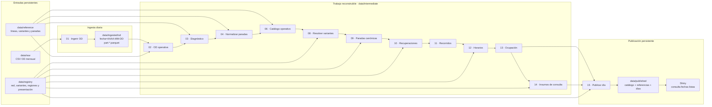
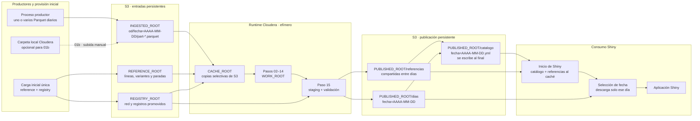
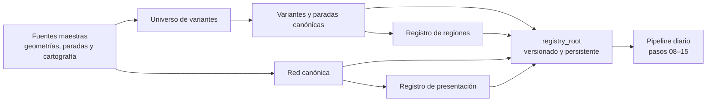

# Flujo completo del pipeline diario

Este documento muestra el recorrido de una fecha OD desde su fuente hasta la
aplicación Shiny. Distingue qué cambia entre una ejecución local y Cloudera,
qué insumos consume cada script y qué resultados quedan persistidos.

## Regla principal

El pipeline tiene tres zonas de datos:

1. **Entradas persistentes:** OD ingerida, referencias maestras y registros
   canónicos.
2. **Trabajo reconstruible:** resultados intermedios de los pasos 02 a 14.
3. **Publicación persistente:** única fuente que puede consumir Shiny.

Shiny nunca debe leer `raw`, `ingested`, `reference`, `registry` ni
`intermediate` directamente.

## Flujo local

En el perfil `local`, todas las raíces viven bajo `data/`. La OD normalizada,
las referencias, los registros y la publicación son persistentes; los
intermedios y el caché pueden reconstruirse.



El paso 05 es un diagnóstico exploratorio opcional que parte del paso 04. El
paso 07 fue retirado y no se ejecuta.

## Flujo en Cloudera y S3

En Cloudera, S3 conserva las entradas y publicaciones. El procesamiento usa
`ASIGNA_FLUJOS_WORK_ROOT` y `ASIGNA_FLUJOS_CACHE_ROOT`, normalmente bajo
`/tmp`; por lo tanto, esos resultados desaparecen al terminar el runtime y se
pueden reconstruir desde S3.



El productor de OD no genera manifiestos: entrega uno o varios archivos
Parquet. El paso 02 los descubre y valida como un único dataset diario. El
script `01b_subir_od_ingestada.R` existe únicamente para cargas manuales desde
una carpeta local de Cloudera; si el productor escribe directamente en S3, no
se utiliza.

## Qué hace cada script

Todas las rutas diarias usan `fecha=AAAA-MM-DD`.

| Paso | Script | Consume | Función principal | Resultado |
|---|---|---|---|---|
| 01 | `01_ingerir_od.R` | CSV mensual de `source_root` | Filtra uno o varios días, normaliza tipos y genera Parquet diarios | `ingested_root/od/fecha=.../part-*.parquet`; localmente también genera controles y manifiesto |
| 01b | `01b_subir_od_ingestada.R` | Uno o varios Parquet locales | Valida esquema y filas; sube solo los Parquet sin exigir manifiesto | `INGESTED_ROOT/od/fecha=.../` en S3 |
| 02 | `02_preparar_od_operativa.R` | OD ingerida + `lineas_metro.csv` | Conserva viajes globales, selecciona columnas operativas y clasifica subsistema/servicio | `od_operativa/fecha=.../` |
| 03 | `03_diagnosticar_variantes.R` | OD operativa + geometrías, paradas y catálogo de líneas | Detecta variantes faltantes o inconsistentes; no modifica la red | `diagnostico_variantes/fecha=.../` |
| 04 | `04_normalizar_paradas_variantes.R` | Diagnóstico + referencias de paradas | Normaliza listas y orden de paradas de las variantes observadas | `paradas_variantes_normalizadas/fecha=.../` |
| 05 | `05_comparar_variantes_misma_linea.R` | Paradas normalizadas + geometrías de la línea | Sugiere candidatas para revisión; es opcional y nunca reemplaza automáticamente | `comparacion_variantes_misma_linea/fecha=.../` |
| 06 | `06_preparar_catalogo_variantes.R` | OD, diagnóstico, geometrías y paradas normalizadas | Arma el catálogo completo de variantes operativas del día | `catalogo_variantes_operativas/fecha=.../` |
| 07 | retirado | — | El inventario incremental antiguo quedó en `en_desuso`; no se ejecuta | — |
| 08 | `08_resolver_variantes_dia.R` | Catálogo operativo + registro de variantes canónicas | Relaciona cada variante observada con su versión canónica promovida | `uso_variantes/fecha=.../` |
| 09 | `09_resolver_paradas_canonicas_dia.R` | OD operativa + paso 08 + registro canónico | Asigna índices y puntos canónicos a origen/destino; separa cuarentenas | `od_paradas_canonicas/fecha=.../` |
| 10 | `10_recuperar_paradas_variantes_distintas.R` | Cuarentena del paso 09 + registro canónico | Recupera destinos exactos o cercanos cuando cambian las variantes | `recuperacion_paradas/fecha=.../` |
| 11 | `11_construir_recorridos_operativos.R` | Pasos 09 y 10 | Agrupa viajes en recorridos procesables y cuarentenas agregadas | `recorridos_operativos/fecha=.../` |
| 12 | `12_estimar_horarios_recorridos.R` | OD + pasos 09–11 + secuencias canónicas | Estima la hora del bus en cada punto de la secuencia | `horarios_recorridos/fecha=.../`, incluyendo `pasadas_bus/` |
| 13 | `13_calcular_ocupacion_recorridos.R` | Horarios + viajes válidos | Calcula subidas, bajadas y ocupación sobre cada recorrido | `ocupacion_recorridos/fecha=.../`, incluyendo `pasadas_ocupacion/` |
| 14 | `14_preparar_insumos_consulta_dia.R` | Ocupación + pasos 08–11 + paradas canónicas promovidas | Genera actividad por parada y viajes de consulta | `insumos_consulta/fecha=.../` con `actividad_paradas/` y `viajes_consulta/` |
| 15 | `15_publicar_dia.R` | Pasos 13 y 14 + registros regionales, canónicos y de presentación | Regionaliza, valida, reutiliza referencias estáticas y publica el catálogo al final | `published_root/referencias`, `published_root/dias/fecha=...` y `published_root/catalogo/fecha=....yml` |

Las rutas de resultado de los pasos 02 a 14 cuelgan de `execution.work_root`:
`data/intermediate` en local y normalmente `/tmp/asigna_flujos_stm/work` en
Cloudera.

## Qué queda guardado

| Categoría | Local | Cloudera | Persistencia | Contenido |
|---|---|---|---|---|
| Fuente OD | `data/raw` | sistema productor o `SOURCE_ROOT` | Persistente fuera del pipeline diario | CSV mensual original, si se conserva |
| OD ingerida | `data/ingested` | `ASIGNA_FLUJOS_INGESTED_ROOT` en S3 | Persistente | Parquet diarios que permiten reconstruir el proceso |
| Referencias | `data/reference` | `ASIGNA_FLUJOS_REFERENCE_ROOT` en S3 | Persistente; provisión inicial o actualización controlada | Líneas, geometrías de variantes, paradas y fuentes geográficas |
| Registros | `data/registry` | `ASIGNA_FLUJOS_REGISTRY_ROOT` en S3 | Persistente y versionado | Variantes canónicas, red canónica, regiones y presentación |
| Intermedios | `data/intermediate` | `ASIGNA_FLUJOS_WORK_ROOT` | Reconstruible; efímero en Cloudera | Checkpoints de los pasos 02–14 |
| Caché | `data/cache` | `ASIGNA_FLUJOS_CACHE_ROOT` | Reconstruible; efímero en Cloudera | Copias locales selectivas de objetos S3 |
| Publicación | `data/published` | `ASIGNA_FLUJOS_PUBLISHED_ROOT` en S3 | Persistente | Único contrato de datos de Shiny |

## Estructura publicada

```text
published_root/
├── catalogo/
│   └── fecha=AAAA-MM-DD.yml          # visibilidad del día; se escribe al final
├── dias/
│   └── fecha=AAAA-MM-DD/
│       ├── pasadas_ocupacion/
│       ├── actividad_paradas/
│       ├── viajes_consulta/
│       ├── controles.csv
│       ├── manifiesto_archivos.csv
│       └── manifiesto.yml
└── referencias/
    └── red=.../
        ├── regiones=.../             # paradas y formas regionales
        └── presentacion=.../          # secuencias y catálogo de vías
```

Un día existe físicamente antes de ser visible. Shiny solo lo ofrece cuando
existe `catalogo/fecha=AAAA-MM-DD.yml` con `estado: listo`. En S3, el paso 15
sube y verifica primero referencias y archivos diarios, y escribe ese catálogo
como última operación.

## Pipeline de referencias

`pipeline_referencias/` no se ejecuta todos los días. Construye y promueve las
versiones maestras que después consume el pipeline diario:



Cuando se crea una versión nueva de referencias o registros, debe promoverse
completa antes de cambiar las versiones configuradas en `config/base.yml`.

## Orden operativo vigente

Para una fecha ya disponible en `ingested_root`, el camino obligatorio es:

```text
02 → 03 → 04 → 06 → 08 → 09 → 10 → 11 → 12 → 13 → 14 → 15
```

El paso 05 es opcional; el 07 no forma parte del flujo. En Cloudera,
`reference_root` y `registry_root` deben estar provisionados en S3 antes de
comenzar. Una vez publicado el día, los controles Shiny vigentes son:

```text
Shiny/scripts/01_validar_adaptador_publicado.R
Shiny/scripts/03_validar_consultas_publicadas.R
```
